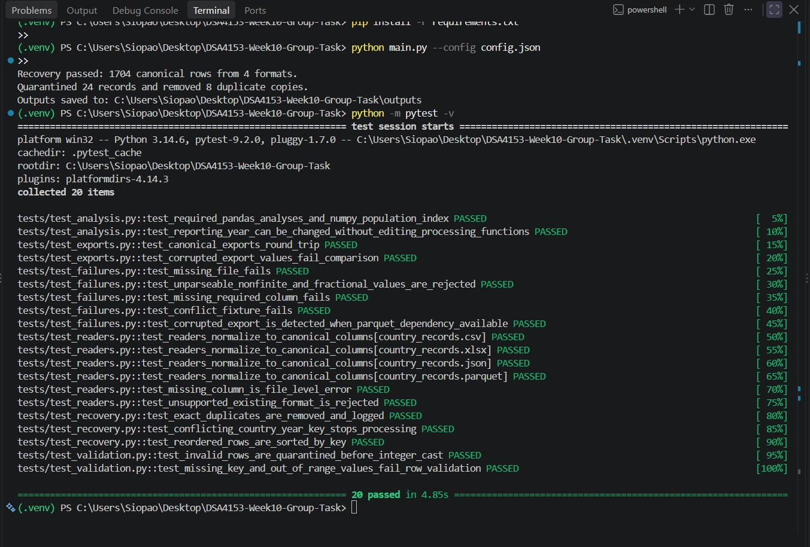
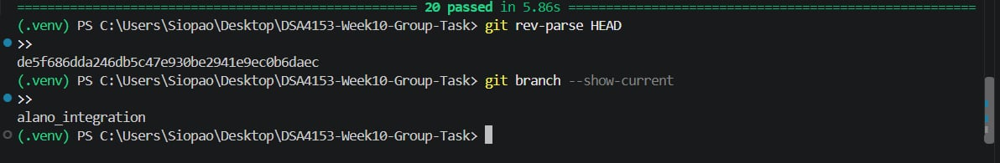

# Independent Verification Report

## 1. Verification Details

- **Verifier:** Pauline Ashley Balangue
- **Verification Method:** Fresh clone of the GitHub repository
- **Repository:** [DSA4153-Week10-Group-Task](https://github.com/paulineashleybalangue-dsa/DSA4153-Week10-Group-Task)
- **Branch:** `alano_integration`
- **Verified Commit:** `de5f686dda246db5c47e930be2941e9ec0b6daec`
- **Operating System:** Windows
- **Python Version:** 3.14.0

## 2. Execution Results

The verifier successfully cloned the repository and executed the recovery program.

```text
Recovery passed: 1704 canonical rows from 4 formats.
Quarantined 24 records and removed 8 duplicate copies.
```

## 3. Automated Test Results

The complete automated test suite was executed successfully.

```text
20 passed in 5.86s
```

All 20 collected tests passed without reported failures.

## 4. Verification Conclusion

Independent verification confirmed that the project could be cloned and executed in a separate Windows environment using the recorded project branch and commit.

The recovery process completed successfully, producing 1,704 canonical records from four input formats. The program also quarantined 24 records and removed 8 duplicate copies. All 20 automated tests passed.

This provides evidence of successful execution and test reproducibility outside the original development environment.

## 5. Evidence

### 5.1 Successful Program Execution and Automated Tests

The screenshot below documents the successful recovery process and all 20 passing automated tests.



### 5.2 Verified Commit and Branch

The screenshot below documents the exact commit hash and branch used during independent verification.

